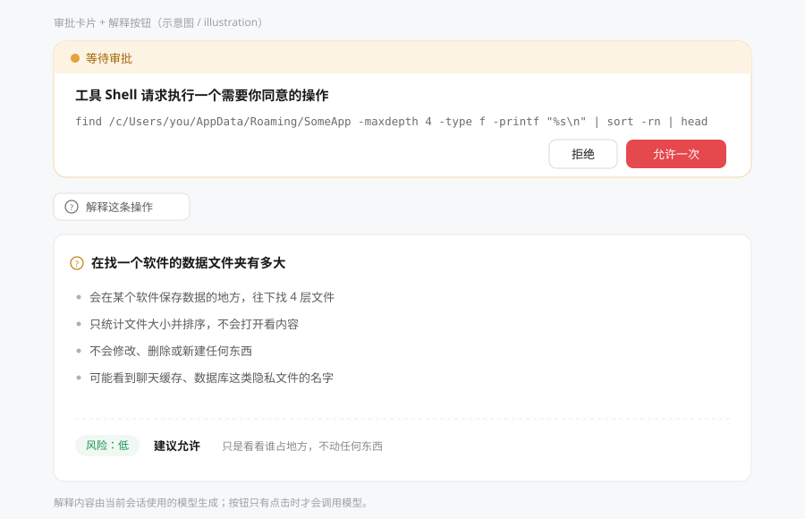

# Approval Translator

[English](README.md) · [简体中文](README.zh-CN.md)

A [DeepSeek Harness](https://github.com/deepseek-ai/deepseek-harness) plugin that puts an **Explain this action** button under the permission approval card — and answers it in plain language.



## Why this exists

When your permission mode is anything but full access, DSH asks before the agent runs a command, edits a file, or calls a privileged tool. The card shows a tool name and the raw argument: a shell command, a JSON blob, a filesystem path.

If you are not a programmer, that is exactly the moment you have to approve something you cannot read — and the safe answer is "reject", which stalls the work.

This plugin adds one button below the card. Clicking it sends that operation to the model of the current session and renders a short explanation:

- what the action does, in one line;
- which files, folders or applications it touches (long paths translated into "the place where {app} keeps its data");
- whether it modifies, deletes or creates anything, and whether anything leaves the machine;
- the privacy risk (accounts, passwords, chat history, databases, photos);
- a risk level (low / medium / high) plus an allow/reject recommendation.

The approval card itself is untouched: **Reject**, **Allow once**, `Enter`, `Esc`, focus handling and accessibility still come from DSH's own component. This plugin only appends content below it.

## Install

**In the app** — open the **Plugins** page, choose **Add plugin** (`添加插件`), and paste one of:

```
dsh-approval-translator
https://github.com/zhaoqiminggg/dsh-approval-translator
```

Then refresh the page (`Ctrl+R`) once.

**With the CLI:**

```sh
# from npm — fastest, no build step
dsh plugin --profile <your-profile> add dsh-approval-translator

# or straight from GitHub source
dsh plugin --profile <your-profile> add github:zhaoqiminggg/dsh-approval-translator
```

(Pick the profile your host actually runs — `desktop` for DSH Desktop, `web` for a plain `dsh web`.)

**From a local checkout** — install the directory itself, which is also the development workflow:

```sh
dsh plugin --profile <your-profile> add /absolute/path/to/dsh-approval-translator
```

## Using it

1. Switch the permission control in the composer to anything that asks before acting.
2. Let the agent run a tool. The approval card appears as usual.
3. Click **Explain this action** under the card.
4. A few seconds later the explanation expands in place. Click again to re-explain.

The button only exists while an approval is pending; in full-access mode there is no card and nothing to explain.

## Cost, latency and behaviour

- **Nothing is sent until you click.** No background requests, no polling.
- One explanation = one model call with the current session's model. No extra configuration, no API key.
- Each `callId` is cached on both the host and the client: clicking twice on the same card reuses the answer.
- The request is bounded: 45 s per attempt, at most two attempts, reasoning effort pinned to the lowest level the model advertises (thinking-heavy models otherwise spend the whole output budget before writing anything).
- If the model returns no text at all, the plugin retries once and then explains which case it was.

> **Language:** explanations are generated in Simplified Chinese. The prompt is written for people who cannot read English or command-line syntax. Making it follow the UI language is on the roadmap.

## How it works (for plugin authors)

Two halves, no build step, no dependencies.

**Host half — `index.js`**
Registers one internal session command, `dsh-approval-translator-explain`, hidden from the slash-command list and from the chat log. On invocation it resolves the correlated `tool/call` event from the session log by `callId` — and only when no `callId` is supplied does it fall back to the newest call of the same tool, so a mismatched id can never make it explain a different operation. It then builds a prompt from the tool name, the raw arguments and the user's last message, and streams the model:

- `llm.prepareCall(...)` with a `configure` callback that picks `model.reasoning.efforts[0]`, so the cheapest available effort is used; falls back to plain `llm.stream` if preparation fails;
- harvests both `text-delta` and `block-end` text, so adapters that only deliver complete blocks still work;
- retries once on an empty reply or a transient call failure;
- returns strict JSON, validated before it reaches the UI.

**Client half — `client.js`**
Takes over the composer chain slot only for approvals:

```js
ctx.slots.inject('conversation.composer', () => ctx.slots.register({
  name: 'conversation.composer',
  priority: 0.5,           // after pending questions (0), before the built-in approval panel (1)
  select: ({ pendingInteraction }) =>
    pendingInteraction?.kind === 'approval' && typeof pendingInteraction.answer === 'function'
      ? pendingInteraction : null,
  ...
}, ApprovalExplainer))
```

Inside, the official card is rendered through `props.renderFactorySlot('conversation.approval.card', …)` — the same inputs the shipped panel passes — and the button plus result panel are appended below it, wrapped in an error boundary. If the factory cannot be rendered, a minimal fallback card keeps Reject / Allow once reachable.

## Privacy & safety

- Reads only the tool call already recorded in **your own** session log.
- Calls the model only on click, using the route your session already uses.
- No telemetry, no analytics, no files written, no network requests of its own.
- The approval decision stays entirely with DSH's official card.

## Compatibility

- Written against DSH `0.2.2-rc.1` and its stable slot APIs (`conversation.composer`, `conversation.approval.card`).
- Plain JavaScript ESM: no build, no dependencies, no peer requirements.
- Requires DSH web/desktop with the approval panel present; on hosts without it the chain entry never matches and nothing changes.

## Development

```sh
npm test    # offline smoke tests: host command flow + client rendering logic (fake React, fake ctx)
npm run check  # syntax + JSON validation
```

Layout:

```
index.js            host half (command + model call)
client.js           client half (slot registration + UI)
cordis.patch.yml    bundle patch
locale/{zh,en}.json plugin-manager title and description
icon.svg            plugin icon
docs/preview.svg    the illustration above
scripts/            offline smoke tests
```

Bump the version in `package.json`, keep `CHANGELOG.md` current, and refresh the page after client-side changes (`index.js` changes need a host restart).

## License

MIT © zhaoqiminggg
