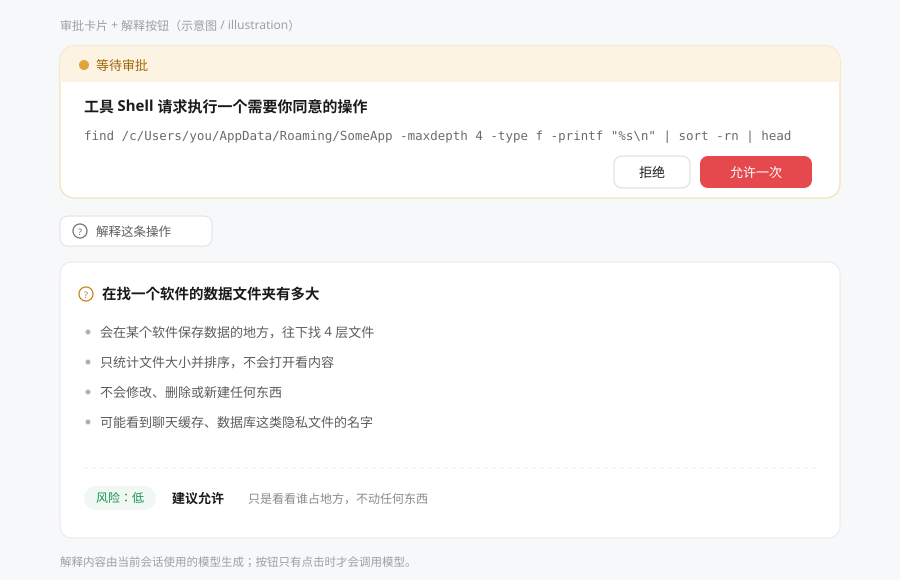

# 审批翻译官

[English](README.md) · [简体中文](README.zh-CN.md)

给 DeepSeek Harness 加一个「**解释这条操作**」按钮：点一下，AI 就把那条看不懂的审批内容翻译成大白话。

> 常见叫法：**审批弹窗解释、审批解释、审批汉化、风险解释**——你如果是这样搜到这里的，那就是它。



---

## 1. 它解决什么问题

权限不是「完全权限」的时候，DSH 每做一件稍微有点风险的事，都会先弹出一个「要不要允许」的审批弹窗。
弹窗里写着一串东西：一条命令、一段 JSON、一个文件路径。

会写程序的人一秒就看懂了；**不会写程序的人只能瞎猜**——猜错要么放行了不该放行的，要么一路拒绝把活儿卡死。

这个插件在弹窗**正下方**加一个按钮。点了，它就把这条操作交给当前会话正在用的模型，翻成四句话：

- 它想干什么；
- 会碰到哪些文件、哪个软件（长路径会翻译成「某个软件存数据的地方」）；
- 会不会修改、删除、新建，会不会把内容传到网上；
- 有没有隐私风险（账号、密码、聊天记录、数据库、照片）。

最后给一个 **风险等级（低/中/高）+ 建议（允许/拒绝）**，看完就能直接做决定。

**官方弹窗一个字都没改**：拒绝、允许一次、回车同意、Esc 拒绝、无障碍全部还是 DSH 自己的；插件只在下面加了东西。

---

## 2. 装它

**在软件里装（推荐）**：打开「插件」页 → 「添加插件」，粘下面任意一个都行：

```
dsh-approval-translator
https://github.com/zhaoqiminggg/dsh-approval-translator
```

装完按 `Ctrl+R` 刷新一次页面。

**用命令行装**（把 `<你的 profile>` 换成实际在跑的那个，桌面版是 `desktop`，普通 `dsh web` 是 `web`）：

```sh
# 走 npm，最快
dsh plugin --profile <你的 profile> add dsh-approval-translator

# 或者直接走 GitHub 源码
dsh plugin --profile <你的 profile> add github:zhaoqiminggg/dsh-approval-translator
```

**从本地目录装**（自己改代码时用）：

```sh
dsh plugin --profile <你的 profile> add /本地目录的绝对路径/dsh-approval-translator
```

---

## 3. 它长什么样

弹窗还是原来那个弹窗，按钮还是「拒绝 / 允许一次」，一个都没动。只是在弹窗**正下方**多了一行：

```
┌───────────────────────────────────────────────┐
│ ⚠ 等待审批                                     │
│ 工具 Shell 请求执行一个需要你同意的操作          │
│ find /c/Users/you/AppData/Roaming/SomeApp ...  │
│                              [拒绝] [允许一次]  │
└───────────────────────────────────────────────┘
  [? 解释这条操作]
```

点「解释这条操作」之后，下面展开一块说明：

```
┌ 这条操作在做什么 ──────────────────────────────┐
│ • 会在某个软件保存数据的地方，往下找 4 层文件   │
│ • 只统计文件大小并排序，不会打开看内容           │
│ • 不会修改、删除或新建任何东西                   │
│ • 可能看到聊天缓存、数据库这类隐私文件的名字     │
│                                                 │
│ 风险：低   建议允许   只是看看谁占地方，不动东西 │
└─────────────────────────────────────────────────┘
```

再点一次按钮会重新解释一遍（想换个说法时用）。

---

## 4. 它怎么保证「说人话」

解释是按「编程零基础、英文不好」这个前提写的：

- 不许出现英文单词和编程术语，必须用的时候会顺带解释一句；
- 电脑路径会翻成人话，例如 `C:\Users\你\AppData\Roaming\某软件` 会说成「某软件保存配置和数据的地方」；
- 一定讲四件事：**想干什么 / 碰到什么 / 会不会改动 / 有没有隐私风险**；
- 最后给一句 **风险等级 + 建议**，方便你直接做决定；
- 参数里看不出来的，它会直说「这一点看不出来」，不瞎编。

它还会参考你当时对 AI 说的那句话，所以能讲清「为什么现在要这么做」。

---

## 5. 花不花钱、会不会卡

- **只有你点按钮才会调用模型**，不点一分钱不花、一点也不占。
- 同一条操作解释过一次就会缓存，重复点不会重复请求。
- 用的是你当前会话正在用的那个模型，不需要另外配置、不需要 API Key。
- 一次请求最多等 45 秒，最多试两次；思考型模型会被压到最低一档思考强度，免得「想太久把话咽回去」。

### 万一它说「模型没有返回内容」

这不是插件坏了，而是**模型这次把话咽回去了**——请求发出去、模型也正常结束，但正文一个字没写。
最常见的原因是：这个模型是「先想很久再说」的类型，思考过程把输出额度吃光了。

插件已经做了三道保险：额度给到 2000 字、思考强度压到最低、空了自动再来一次。
看到提示时，直接再点一次「重新解释」通常就好了。

---

## 6. 安全性说明

- 这个插件**不执行**被解释的那条操作，它只是把操作的内容读出来翻译。
- 它看的是**你自己会话里已经记录下来的**那次工具调用参数，不读取别的地方。
- 唯一的外部请求，是你点按钮时发给当前会话模型的这一次调用；没有埋点、没有统计、不写文件。
- 官方审批弹窗是原样渲染的：回车同意、Esc 拒绝、按钮状态、无障碍全部保持不变。
- 万一「解释」这块自己出问题，有兜底：解释区域会自己消失，官方弹窗的「拒绝 / 允许一次」不受影响。

---

## 7. 什么时候会出现

只有**权限不是「完全权限」**、DSH 弹出批准请求时才会出现。
完全权限模式下不会有审批弹窗，自然也就没有这个按钮。

---

## 8. 已知限制

- **解释目前只输出简体中文**。提示词就是按「看不懂英文的用户」写的；跟着界面语言切换在 Roadmap 里。
- 依赖 DSH 的审批弹窗（代码里叫 `conversation.approval.card`）。如果哪天 DSH 改了这套插槽，需要跟着升级插件。
- 模型偶尔会解释得不准确；它拿到的只有工具名、参数和你上一句话，没有完整上下文。**拿不准时，以「拒绝」为安全默认。**

---

## 9. 怎么关掉 / 卸载

设置 → 插件里找到「审批翻译官」，关掉即可；想彻底删掉就在插件管理里卸载。
关掉之后弹窗恢复成原样，没有任何残留。

---

## 10. 给开发者

```
index.js            Host 半：内部命令 + 找 tool/call 参数 + 调模型
client.js           Client 半：插槽注册 + 界面
cordis.patch.yml    bundle 补丁
locale/{zh,en}.json 插件管理里显示的标题和说明
icon.svg            图标
docs/preview.svg    上面那张示意图
scripts/            离线冒烟测试（假 React、假 ctx，不需要启动 DSH）
```

```sh
npm test          # 跑离线冒烟测试
npm run check     # 语法 + JSON 校验
```

- 改 `client.js` 之后：页面刷新（Ctrl+R）生效。
- 改 `index.js` 之后：插件需要重载（在插件页关掉再打开，或重启 DSH）。
- 提交前请同步 `CHANGELOG.md` 和 `package.json` 的版本号。

---

## 许可证

MIT © zhaoqiminggg
